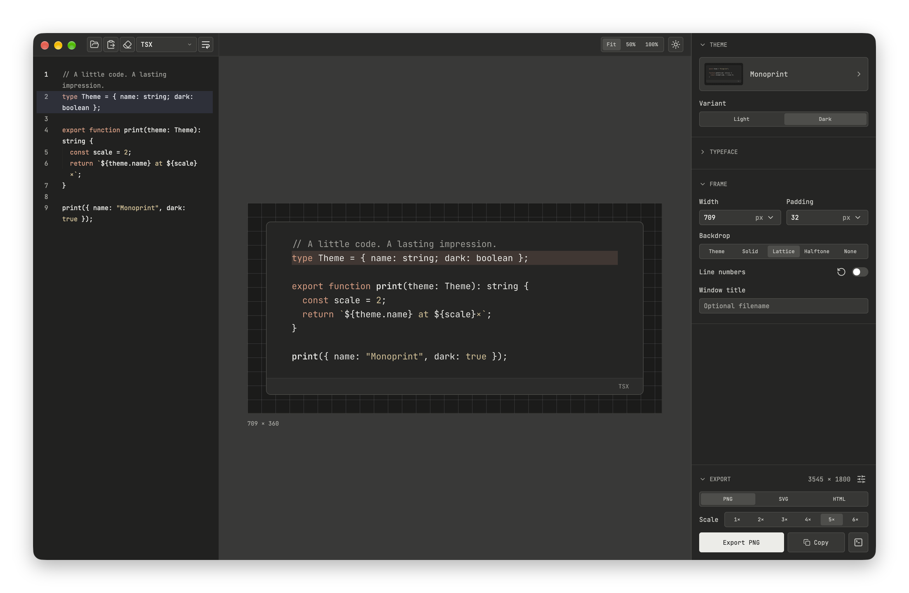
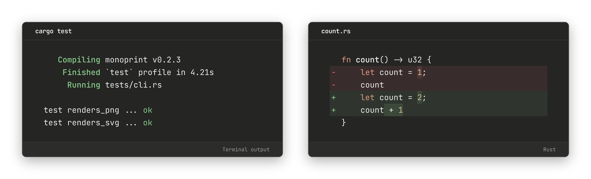

# Monoprint

Create code images locally with a native desktop editor, a CLI, and Rust and
Node.js APIs. Export PNG, SVG, or self-contained HTML.

<p align="center">
  
</p>

Fonts, themes, and syntax grammars are bundled. Rendering runs on your device
without a browser, network connection, or installed fonts.

Besides source code, it renders
[terminal output and code changes](docs/terminal-and-changes.md):

<p align="center">
  
</p>

```sh
monoprint fixtures/example.ts --highlight 6 -o code.png
cargo test --color=always 2>&1 | monoprint -l ansi --title 'cargo test' -o terminal.png
monoprint --diff fixtures/diff/before.rs fixtures/diff/after.rs -o change.png
```

See more themes and a demo of the desktop editor on the
[website](https://monoprint.7ea.st).

## Install

On an Apple Silicon Mac (macOS 12 or newer), install the signed and notarized
app and its CLI with Homebrew:

```sh
brew install --cask ozanvos/tap/monoprint
```

The app includes automatic updates. To update through Homebrew, run
`brew update && brew upgrade --cask --greedy monoprint`.
See the [official tap](https://github.com/ozanvos/homebrew-tap) for uninstalling
or adopting an existing manual installation.

Direct downloads for macOS and Linux (x64 and ARM64 AppImages) are on the
[website](https://monoprint.7ea.st/#downloads). Windows downloads are coming later.

For Node.js 22+ applications:

```sh
npm install monoprint
```

The [Node.js API](bindings/node/README.md) includes prebuilt bindings for macOS
arm64/x64, Linux glibc arm64/x64, and Windows x64. No Rust toolchain is needed.

## Build from source

Requires Rust 1.97 or newer and a C compiler. The desktop app also needs the
[platform prerequisites](apps/monoprint-gui/README.md).

```sh
# Desktop editor
cargo run --locked --release --manifest-path apps/monoprint-gui/Cargo.toml

# CLI
cargo build --locked --release --target-dir target
./target/release/monoprint fixtures/example.ts -o example.png
```

Choose a theme, adjust the typeface and layout, add line or text highlights,
and export. Themes support light and dark appearances, custom backgrounds,
and transparent surroundings.

## Guides

- [Desktop editor](apps/monoprint-gui/README.md)
- [CLI options](docs/cli.md)
- [Terminal output and code changes](docs/terminal-and-changes.md)
- [Rust API](docs/library.md)
- [Node.js and TypeScript](bindings/node/README.md)
- [Themes](docs/theme-expansion.md)

## Development

```sh
cargo fmt --package monoprint -- --check
cargo clippy --locked --all-targets -- -D warnings
cargo test --locked --release
```

See [asset maintenance](docs/maintenance.md) and [release packaging](docs/release.md).

## License

Original code is Apache-2.0. Dependencies and bundled assets retain their own
licenses; see [third-party notices](THIRD_PARTY_NOTICES.md).
